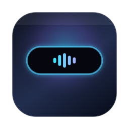
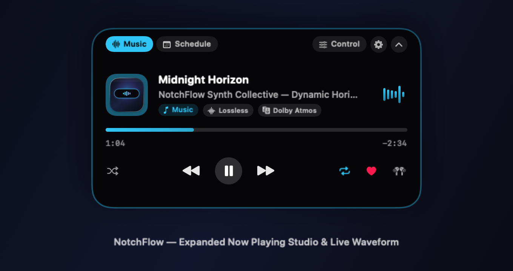
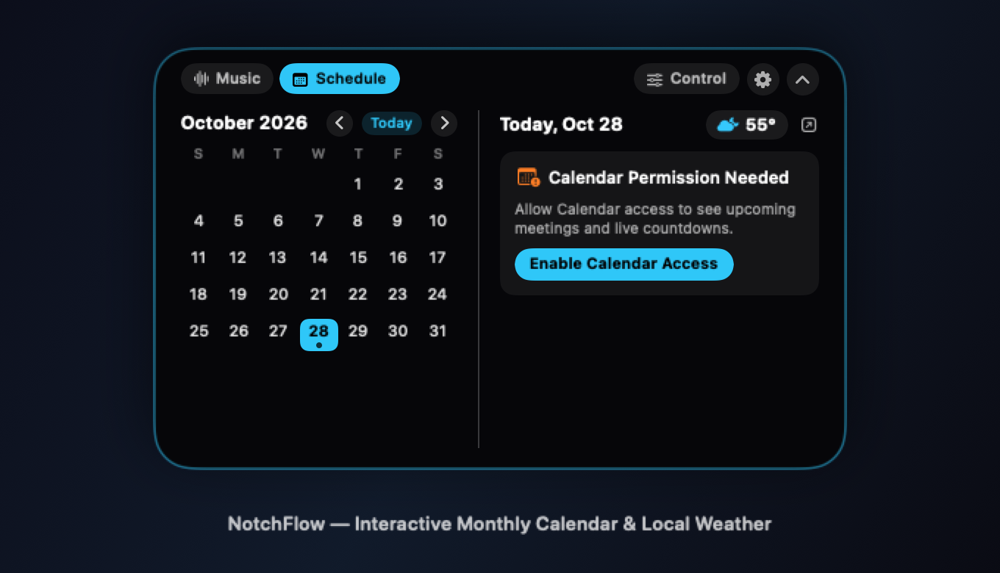
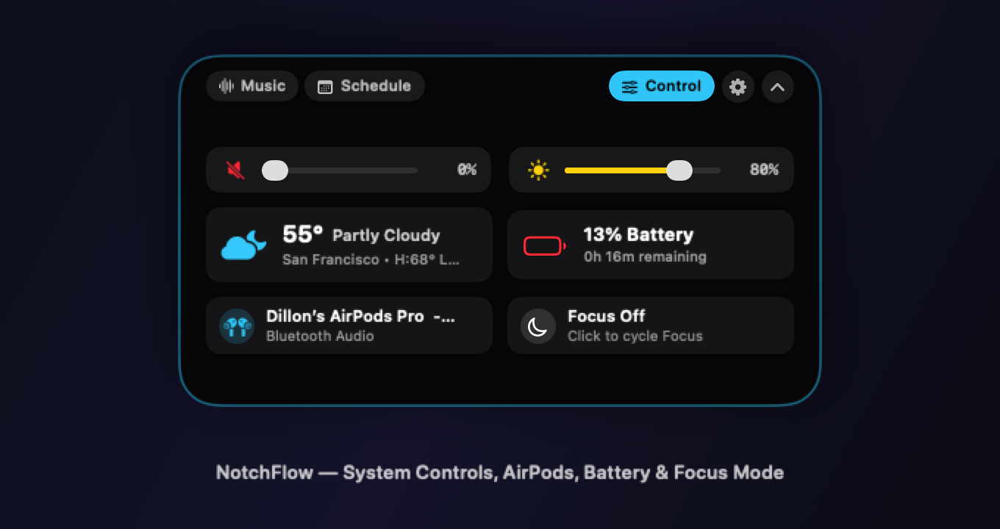
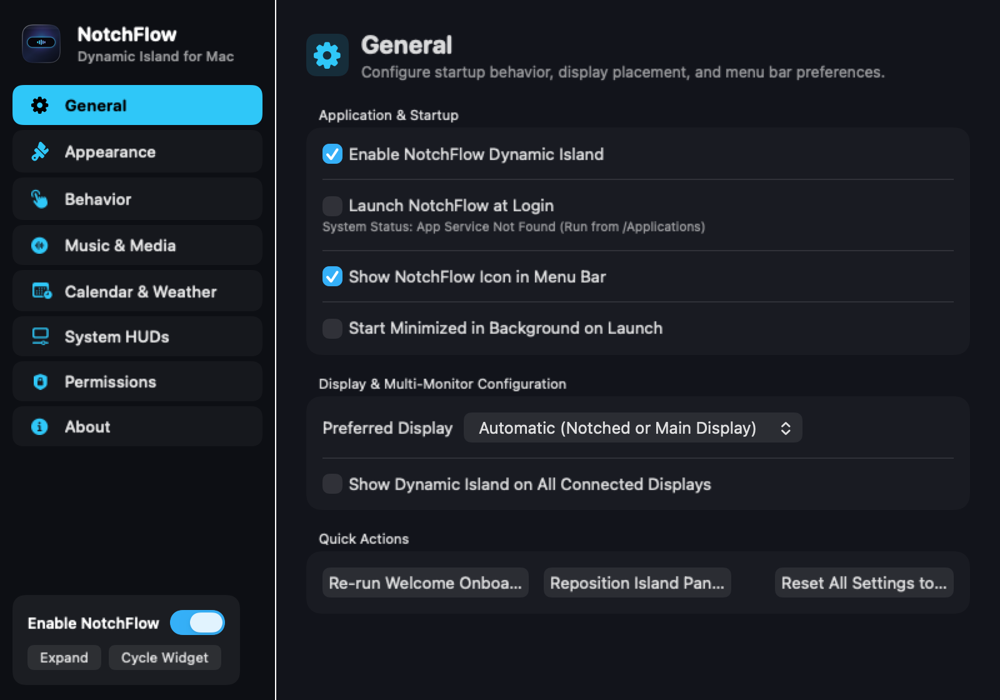
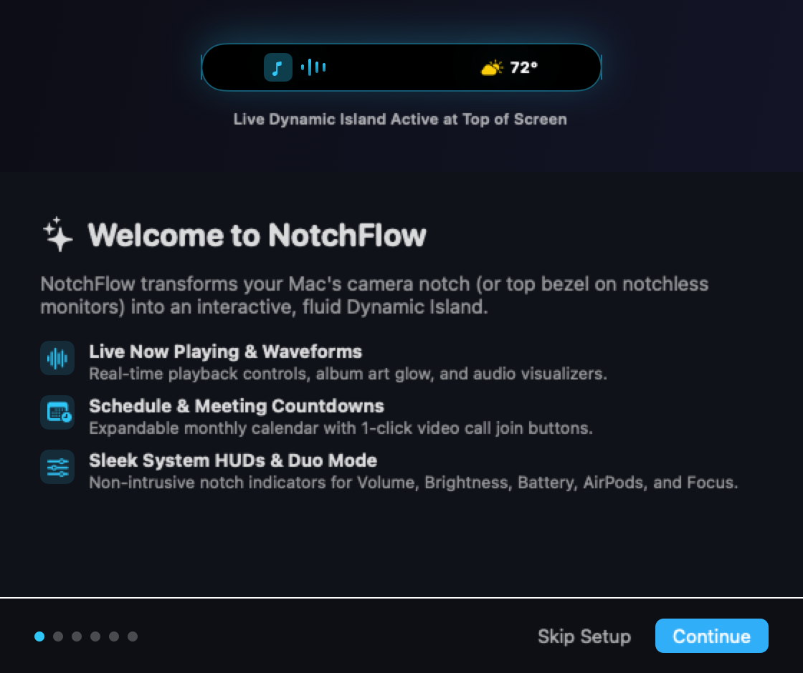

<div align="center">



# NotchFlow

**A free, open-source Dynamic Island for macOS — bringing Now Playing music, calendar countdowns, weather, system HUDs, and fluid spring animations to your Mac's notch.**

[](https://github.com/Manateek1/NotchFlow)
[](https://swift.org)
[](LICENSE)
[](https://github.com/Manateek1/NotchFlow/actions)

</div>

---

## Overview

**NotchFlow** is a lightweight, native macOS utility built with **Swift**, **SwiftUI**, and **AppKit** that transforms the MacBook camera notch—or the top bezel of any external/notchless monitor—into an interactive, iPhone-inspired **Dynamic Island**.

Designed with a strict **public-API-first, zero-telemetry** philosophy, NotchFlow integrates with **Apple Music**, **Spotify**, **macOS Calendar (`EventKit`)**, **Weather (`CoreLocation` + Open-Meteo)**, **CoreAudio**, and **IOKit** without Electron bloat, paid subscriptions, or mandatory accounts.

> **Disclaimer:** NotchFlow is an independent open-source project created by **Dillon Nagar**. It is not affiliated with, endorsed by, or sponsored by Apple Inc. or Alcove.

---

## Screenshots

<p align="center">
  
</p>

<p align="center">
  
</p>

<p align="center">
  
</p>

<p align="center">
  
</p>

<p align="center">
  
</p>

---

## Features

### 1. Core Dynamic Island Engine (`AppKit` + `SwiftUI`)
- **Hardware Notch & Simulated Pill Modes:** Automatically detects the physical camera housing on notched MacBooks (`NSScreen.safeAreaInsets`, `auxiliaryTopLeftArea`, `auxiliaryTopRightArea`) and provides a floating iOS-style pill mode on external or notchless displays.
- **Non-Activating Floating Panel (`NotchIslandPanel`):** Floats cleanly at the menu bar level across Spaces and full-screen auxiliary contexts without stealing keyboard focus from your active app or cluttering the Dock/App Switcher.
- **Precision Passthrough Hit-Testing (`PassthroughHostingView`):** Clicks and cursor movement outside the active island geometry pass 100% transparently through to the underlying macOS menu bar and application windows.
- **10 Modular Island States:**
  1. `Hidden` (when disabled or auto-hidden in fullscreen games/video)
  2. `Minimal Idle` (subtle notch-hugger indicator)
  3. `Compact Pill` (single active compact widget)
  4. `Duo Mode` (simultaneous split view: e.g., Music on the left wing + Calendar countdown or Weather on the right wing)
  5. `QuickPeek Notification` (priority-queued temporary banner that expands briefly and restores the previous state)
  6. `Music Activity`
  7. `Calendar Activity`
  8. `System HUD Activity` (with elastic spring overshoot)
  9. `Lock / Unlock Activity`
  10. `Expanded Studio Panel`

### 2. Music & Now Playing System
- **Event-Driven Media Providers:** Instantaneous track and playback state updates from **Apple Music** (`com.apple.Music.playerInfo`) and **Spotify** (`com.spotify.client.PlaybackStateChanged`) via `DistributedNotificationCenter` and `NSAppleScript`, plus optional web browser tab support.
- **Full Transport & Scrubbing Controls:** Play, Pause, Next Track, Previous Track, interactive progress bar scrubbing, Shuffle, Repeat (`off` / `all` / `one`), Favorite/Like, Podcast playback speed (`0.75x`–`2.0x`), and an inline output volume slider.
- **Dynamic Artwork & Waveforms:** Extracts the dominant color from album artwork for ambient glow and dynamic accents, dims artwork on pause, displays format badges (`Lossless`, `Dolby Atmos`, `Explicit`, `Podcast`), and renders 4 customizable live waveform styles (`Harmonic Equalizer Bars`, `Fluid Sine Wave`, `Spectrum Matrix`, `Minimal Beat Pulse`).

### 3. Calendar & Weather Integration
- **Native `EventKit` Schedule:** Displays ongoing and upcoming meetings with live countdowns (`in 14m`, `Now • 20m left`), calendar color indicators, and 1-click **Join** buttons for Zoom, Google Meet, Microsoft Teams, Webex, and FaceTime links.
- **Interactive Monthly Calendar:** Navigate months, inspect days with event indicator dots, filter specific calendars, and open macOS Calendar with a single click.
- **Zero-Config Weather:** Powered by optional `CoreLocation` or custom city geocoding via Open-Meteo (requiring no API keys or paid developer accounts), with °F/°C support, daily high/low temperatures, precipitation probability, and 20-minute local caching.

### 4. System HUDs & QuickPeek Queue
- **Volume & Mute (`CoreAudio`):** Event-driven property listeners on the default output device with interactive slider control.
- **Display Brightness (`IOKit`):** Reads and adjusts internal display brightness (`IODisplayGetFloatParameter` / `IODisplaySetFloatParameter`) with graceful fallback on external monitors.
- **Battery & Power (`IOPowerSources`):** Zero-polling `CFRunLoop` power source notifications for Charger Connected/Disconnected, Low Battery (`<=20%`), Fully Charged (`100%`), and Low Power Mode transitions.
- **Connectivity & Audio Outputs (`CoreAudio` + `IORegistry`):** Detects AirPods, AirPods Pro, AirPods Max, HomePod, Beats, and Bluetooth headphones along with Bluetooth battery levels exposed in `IORegistry`.
- **Focus Mode:** Observes Do Not Disturb changes and provides an interactive 6-profile Focus selector (`Off`, `Do Not Disturb`, `Work`, `Personal`, `Sleep`, `Deep Coding`).

---

## Requirements

- **Operating System:** macOS 15.0 (Sequoia) or newer (tested on macOS 15 & macOS 26 Tahoe)
- **Architecture:** Apple Silicon (`arm64`) and Intel (`x86_64`) Universal build support
- **Build Tools (for building from source):** Xcode 16.0+ and Swift 5.10 / 6.0

---

## Installation

### Option 1: Download Prebuilt Release
1. Download `NotchFlow-macOS.zip` from the [GitHub Releases](https://github.com/Manateek1/NotchFlow/releases) page.
2. Unzip `NotchFlow.app` and drag it into `/Applications`.
3. **Important — Unsigned Open-Source App Note:** Because NotchFlow is distributed freely without a paid Apple Developer ID notarization certificate, macOS Gatekeeper may show an "unverified developer" prompt on first launch. Clear the quarantine attribute in Terminal before opening:
   ```bash
   xattr -cr /Applications/NotchFlow.app
   open /Applications/NotchFlow.app
   ```

### Option 2: Build from Source
```bash
git clone https://github.com/Manateek1/NotchFlow.git
cd NotchFlow

# Build Release .app bundle
xcodebuild -project NotchFlow.xcodeproj \
  -scheme NotchFlow \
  -configuration Release \
  -destination 'platform=macOS' \
  build

# RunAutomated Unit Tests
xcodebuild -project NotchFlow.xcodeproj \
  -scheme NotchFlow \
  -destination 'platform=macOS,arch=arm64' \
  test
```

You can also open `NotchFlow.xcodeproj` directly in Xcode and press **Cmd+R**.

---

## Usage Instructions

- **Hover or Click:** Move your cursor over the notch (or click it) to expand the Dynamic Island.
- **Click Outside:** Click anywhere outside the expanded island to collapse it back into the notch.
- **Two-Finger Trackpad Swipes:**
  - Swipe **left/right** on the island to skip tracks (when in Music mode) or cycle between active widgets.
  - Swipe **down** to expand the island; swipe **up** to collapse or dismiss a QuickPeek notification.
- **Middle-Click:** Cycles the active compact widget (`Music` → `Calendar` → `Weather` → `Battery` → `Connectivity` → `Focus`), or customize middle-click in **Settings > Behavior**.
- **Menu Bar Item:** Click the NotchFlow icon in the macOS menu bar for quick transport controls, Duo Mode toggling, HUD test triggers, or opening **Settings (`Cmd+,`)**.
- **Command-Line Flags:**
  - `--open-settings`: Opens the Settings window immediately on launch.
  - `--open-onboarding`: Opens the Welcome Onboarding flow.
  - `--demo-music`: Loads sample lossless track metadata and expands the Music studio player.

---

## Permissions

NotchFlow never requests all permissions upfront. Each permission is optional and requested contextually:

| Permission | Framework | Purpose | Fallback if Declined |
| :--- | :--- | :--- | :--- |
| **Calendars** | `EventKit` | Upcoming events, meeting countdowns, and monthly calendar grid. | Shows a 1-click "Enable Calendar Access" card in the Calendar tab; all other features work normally. |
| **Automation (Apple Events)** | `NSAppleScript` | Controlling playback and reading artwork from Apple Music / Spotify. | Passive `DistributedNotificationCenter` metadata still updates when tracks change. |
| **Location Services** | `CoreLocation` | Fetching local weather for your current coordinates. | Automatically falls back to your configured custom city or system timezone region. |
| **Accessibility** *(Optional)* | `ApplicationServices` | Optional enhanced media key handling. | Not required for core Dynamic Island hover, click, or HUD functionality. |

---

## Technical Limitations & macOS Security Boundaries

In accordance with our commitment to clean engineering and operating-system security boundaries:
1. **Secure Lock Screen Overlays (`loginwindow`):** macOS security architecture prohibits non-privileged third-party applications from rendering interactive windows above the secure system `loginwindow` Lock Screen. NotchFlow observes `com.apple.screenIsLocked`, `com.apple.screenIsUnlocked`, and screensaver notifications to play lock/unlock transition animations, optionally hide sensitive schedule details while locked, and cleanly restore your active island state upon unlock.
2. **System-Wide Media Interception (`MediaRemote`):** Starting in macOS 15.4+ and macOS 26, Apple restricts private `MediaRemote.framework` entitlements for non-system binaries. Rather than using brittle private API hacks that crash or fail on modern macOS, NotchFlow uses public `DistributedNotificationCenter` broadcasts (`com.apple.Music.playerInfo` and `com.spotify.client.PlaybackStateChanged`) paired with modular `NSAppleScript` drivers for Apple Music, Spotify, and web browsers.
3. **External Display Hardware Brightness (DDC/CI):** Standard `IOKit` `IODisplaySetFloatParameter` controls the built-in MacBook display and Apple displays natively. Third-party external monitors connected via HDMI/DisplayPort that do not expose `IODisplayConnect` parameters gracefully fall back in the Brightness manager.

---

## Troubleshooting

- **The Dynamic Island does not appear:** Ensure **Enable NotchFlow** is checked in **Settings > General**, and verify that your current application is not in fullscreen mode if **Automatically Hide Island in Fullscreen Apps** is enabled.
- **Apple Music or Spotify controls do not respond:** Open **System Settings > Privacy & Security > Automation** and ensure **NotchFlow** is allowed to control **Music** or **Spotify**.
- **Calendar events are empty:** Open **NotchFlow Settings > Calendar & Weather** and click **Grant Calendar Access** (or verify access in **System Settings > Privacy & Security > Calendars**).

---

## Roadmap

- [ ] Drag-and-drop temporary file shelf (Dropover-style tray inside the notch)
- [ ] Apple Shortcuts (`AppIntents`) actions for triggering custom QuickPeek notifications
- [ ] Customizable per-app island color profiles
- [ ] Timer & Pomodoro live activity widget

---

## Contributing

Contributions, bug reports, and feature requests are welcome! Please read [CONTRIBUTING.md](CONTRIBUTING.md) for build instructions and architecture guidelines.

---

## License & Credits

- **Author & Maintainer:** Dillon Nagar ([@Manateek1](https://github.com/Manateek1))
- **License:** Released under the [MIT License](LICENSE).
- **Privacy:** Read our full [Privacy Statement](PRIVACY.md).
